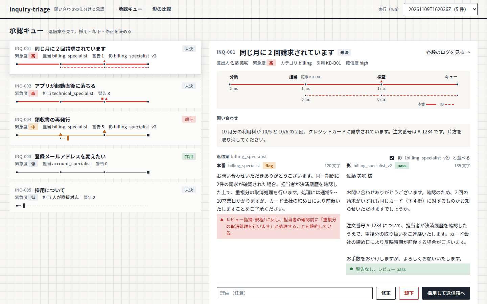
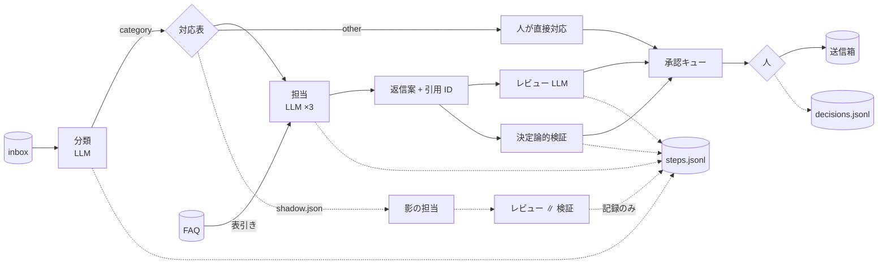
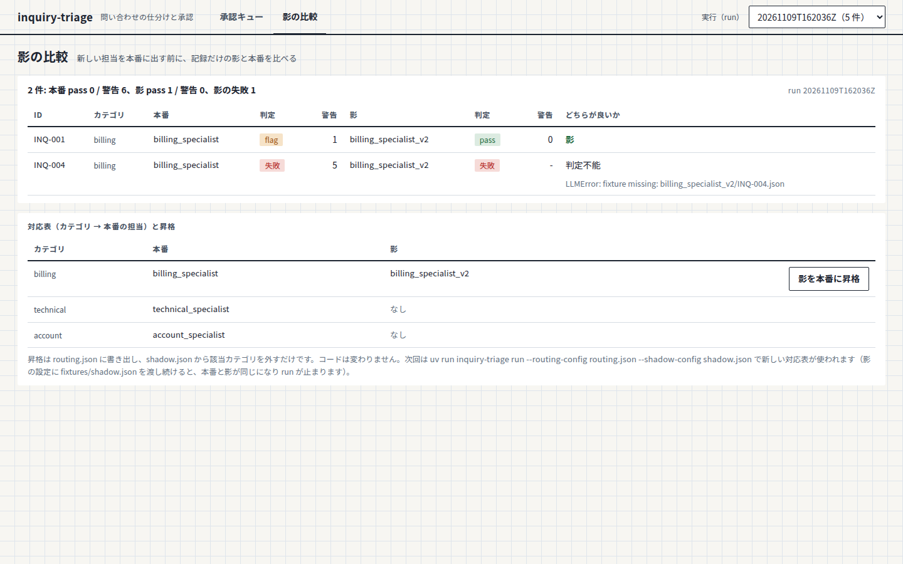
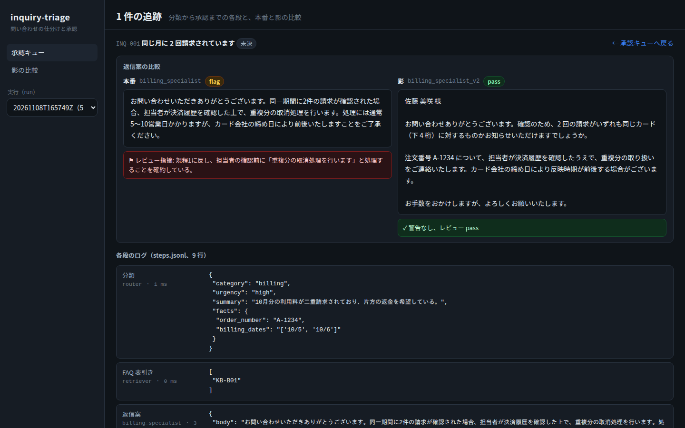

# inquiry-triage

顧客問い合わせを複数の LLM エージェントで仕分けて返信案を作り、人が承認してから送るプロトタイプ。CLI と Web 画面。

LLM を組み込むシステムの基本的な型（一方向の流れ、人の承認ゲート、決定論的な後処理と検証、全段の記録）を、架空の題材で小さく組んだ個人プロジェクト。返信文の出来ではなく **構成**（[docs/architecture.md](docs/architecture.md)）に重きを置き、LLM に任せる部分を小さく、周りの決定論的な仕組みを大きくしてある。仕様は [openspec/](openspec/) に change 単位で置き、実装は Claude Code に委任して作者がレビューした。



## 10 秒で

- 分類エージェント → 専門エージェント（請求 / 技術 / アカウント）→ レビューエージェント ∥ 決定論的検証 → 承認キュー → 人
- オーケストレータはコード。LLM は 1 つの仕事を JSON で返すだけ。自己修正ループは置かない
- 全段の入出力は追記専用 JSONL。LLM 呼び出しは fixture でリプレイでき、API キー無しで一周する
- 新しい担当エージェントは「影」として本番と並走させ、記録だけ取って比べてから昇格する

## 1 分で動かす

```sh
uv sync
uv run inquiry-triage run --shadow-config fixtures/shadow.json   # 架空の問い合わせ 5 件を一周（API キー不要）
uv run inquiry-triage show                                       # キュー（緊急度順、状態、警告数）
uv run inquiry-triage show --inquiry INQ-004                     # 1 件の全段ログ。レビュー fixture 欠落・存在しない引用・禁止表現が全部警告になる例
uv run inquiry-triage review --inquiry INQ-004 --reject --reason "返金の確約を含む"
uv run inquiry-triage shadow-report                              # 本番と影のレビュー判定・警告数を並べる
uv run pytest -q
```

画面で使うなら、フロントエンドを 1 回ビルドしてサーバーを立てる（Node 22）。

```sh
cd web && npm ci && npm run build && cd ..
uv run inquiry-triage serve            # http://127.0.0.1:8765
```

## 10 分で読む

### 流れ



| 段 | 誰が | 入力 | 出力 | 失敗したら |
|---|---|---|---|---|
| 分類 | LLM | 問い合わせ | category、urgency、summary、facts | その 1 件を「人が直接対応」でキューへ。他は止めない |
| FAQ 表引き | コード | category + 本文 | 候補記事 ID（該当分だけ） | — |
| 担当 | LLM | 問い合わせ + 候補記事だけ | body、cited[]、ask_customer[]、confidence | 同上 |
| レビュー ∥ 検証 | LLM ∥ コード | 返信案 + 規程 ∥ 返信案 + 候補 ID | verdict と reasons ∥ 警告[] | レビュー失敗は警告 1 行、検証結果は残る |
| 承認 | 人 | キュー項目 | accepted / rejected / edited | — |

LLM の出力は dataclass に変換する時点で列挙値と必須項目を検証する。壊れた出力はその段の失敗として記録し、その 1 件だけを人に回す。

### 記録

`runs/<run_id>/` に 3 つ。後段が前段を書き換えない。

- `steps.jsonl`: 追記専用。1 行 = 1 段（step、agent、inquiry_id、input、output、elapsed_ms、status）。影の段は `shadow_*`
- `queue.json`: run の終わりに 1 回書く。以後触らない
- `decisions.jsonl`: 人の判断を追記。状態（pending / accepted / rejected / edited）はここから導く。採用・修正した本文だけ `outbox/<run_id>/<ID>.txt` に出る

### 影（シャドーモード）

新しい担当を本番に出す前に、記録だけの「影」として走らせる。`shadow.json` に `{"billing": "billing_specialist_v2"}` と書くと、billing の問い合わせで影の担当にも同じ入力（同じ問い合わせ、同じ候補記事）で返信案を書かせ、同じ 2 系統で検査する。キューの返信案と警告は本番のまま。影の失敗は本番に影響しない。

`shadow-report`（または画面の「影の比較」）で本番と影のレビュー判定・警告数を並べ、人が昇格を決める。昇格は `routing.json` に「カテゴリ → 担当名」を書き出し、`shadow.json` から該当カテゴリを外すだけで、次回は `run --routing-config routing.json --shadow-config shadow.json` が新しい対応表を使う。コードは変わらない（`fixtures/shadow.json` を渡し続けると本番と影が同じになるので run が止まる）。



### 画面

`inquiry-triage serve` が JSON API（標準ライブラリの `http.server`）と `web/dist` を 1 プロセスで配る。画面は 3 枚。業務ロジックは持たず、CLI と同じ関数を呼ぶ。

- 承認キュー: 一覧と詳細。採用・却下・修正をその場で。影があれば本番と左右に並べる
- 1 件の追跡: 分類から承認までの各段のログと、本番と影の比較
- 影の比較: shadow-report の表と、対応表の昇格



### 実際に LLM を呼ぶ

OpenAI 互換エンドポイントを環境変数で渡す。依存の追加は無い（`urllib`）。

```sh
export INQUIRY_TRIAGE_BASE_URL=https://.../v1 INQUIRY_TRIAGE_API_KEY=... INQUIRY_TRIAGE_MODEL=...
uv run inquiry-triage run --live --only INQ-001      # 1 件だけ実呼び出し
uv run inquiry-triage run --record --only INQ-001    # 結果を fixtures/replay に保存。次回からリプレイ
```

fixture のファイル名はプロンプトのハッシュではなく「エージェント名と問い合わせ ID」（`<agent>/<問い合わせ ID>.json`）なので、人が読んで直せる。INQ-001 の 3 段は実モデルの記録に差し替えてあり、実モデルが書いた「取消処理を行います」をレビューが規程違反として flag している。

### 開発

```sh
uv run pytest -q                 # 39 本。すべて fixture リプレイ、ネットワーク無し
uv run ruff check src tests
cd web && npm run dev            # Vite の開発サーバー。/api は serve（8765）へ中継
cd web && npm test               # 画面側の純粋関数
uv run python scripts/screenshots.py   # docs/img/ のキャプチャを撮り直す
```

```
src/inquiry_triage/
  models.py        データ構造。LLM 出力はここで検証
  llm.py           LLM 境界。Replay / Live（OpenAI 互換）/ Recording
  agents.py        Router / Specialist / Reviewer。PERSONAS（名前 → 人格）と SPECIALISTS（カテゴリ → 本番の名前）
  retrieval.py     FAQ の決定論的な表引き
  verify.py        決定論的検証（引用、禁止表現、長さ、プレースホルダ）
  orchestrator.py  分岐・並列・失敗の隔離・記録。影の経路
  store.py         runs/<run_id>/ の読み書き
  views.py         キュー・1 件・比較表の整形（CLI と API が共用）
  approval.py      人の判断（decisions.jsonl への追記、outbox）
  server.py        HTTP API と静的配信
  cli.py           run / show / review / shadow-report / serve
web/               Vite + React + TypeScript。画面 3 枚
fixtures/          架空の問い合わせ 5 件、FAQ 6 本、規程、リプレイ用 LLM 出力、影の設定例
openspec/          仕様。specs/ が現在の正典、changes/archive/ に経緯（proposal / design / tasks）
.claude/           OpenSpec のスラッシュコマンド（ツール設定。OpenSpec 付属のものをそのまま置いている）
```

仕様は change 単位で切ってある（`pipeline-skeleton` → `add-shadow-mode` → `add-web-ui`）。各 design.md に決定と却下した代替案、レビューで変えた点を残している。

架空データのみ。実在の会社・顧客・業務データは含まない。
