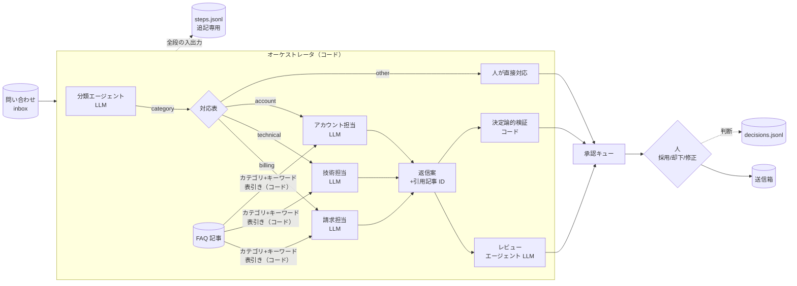

# 構成案

題材: 顧客問い合わせの一次対応。役割の違うエージェントが分業して返信案を作り、人が承認してから送る。

## 構成図

直列: 分類 → 担当 → 検査 → 承認。並列: 問い合わせ同士（4 ワーカー）、レビューと検証（2 系統）。

## エージェントの一覧

| 役割 | 種類 | 入力 | 出力（構造化） | 失敗したら |
|---|---|---|---|---|
| 分類 | LLM | 問い合わせ | category, urgency, summary, facts | その 1 件を「人が直接対応」でキューへ。他は止めない |
| 請求 / 技術 / アカウント担当 | LLM ×3 | 問い合わせ + 該当 FAQ 記事だけ | body, cited[], ask_customer[], confidence | 同上 |
| レビュー | LLM | 問い合わせ + 返信案 + 規程 | verdict (pass/flag), reasons[] | 「レビュー失敗」の警告だけ付けて検証結果は残す |
| FAQ 取得 | コード | category + 本文 | 候補記事 ID | — |
| 決定論的検証 | コード | 返信案 + 候補記事 ID | 警告[] | — |
| オーケストレータ | コード | 全部 | キュー + ログ | — |
| 承認 | 人 | キュー項目 | accept / reject / edit | — |

## 技術的な工夫

1. **オーケストレータはコード、LLM は 1 つの仕事だけ**。分岐（どの担当に回すか）は対応表、並列・再試行・記録はコード。同じ入力は同じ経路を通り、「なぜこの担当に回ったか」に答えられる。
2. **自己修正ループを置かない**。レビューの指摘は担当エージェントに戻さず、警告として人に見せる。収束しないループにコストと間違いが隠れるのを防ぐ。
3. **根拠の取得は決定論的**。FAQ 記事はカテゴリとキーワードの表引きで選び、担当エージェントには該当記事だけを渡す（文脈の物理削除）。返信案は引用記事 ID を返し、検証が「候補に無い ID」を機械的に弾く。
4. **検査は 2 系統を並列**。決定論的に判定できること（引用の存在、禁止表現、長さ、プレースホルダ）は LLM に聞かない。LLM にしか判定できないこと（規程違反の疑い、顧客感情への配慮）だけレビューエージェントに聞く。
5. **構造化出力は境界で検証**。列挙値・必須項目を dataclass に変換する時点で検証し、壊れた出力は失敗として記録して人に回す。

## 運用

1. **全段の入出力を追記専用 JSONL に記録**。問い合わせ ID 1 つで「分類 → 渡した記事 → 返信案 → 検査結果 → キュー」が追える（`show --inquiry INQ-004`）。
2. **失敗の隔離**。1 件のエージェント失敗は、その 1 件を「人が直接対応」に落とすだけ。バッチは止まらない。
3. **リプレイモード**。LLM の入出力を fixture（`replay/<agent>/<問い合わせID>.json`）に保存し、API キーもネットワークも無しで同じ結果を再現する。デモとテストは全部これで回る。実運用では RecordingClient で実出力から fixture を作り直す。
4. **シャドーモード（予定）**。新しい担当エージェントは出力を記録するだけでキューに出さず、既存経路と並べて人が比較する。採用率が基準を超えたら有効化する。段階的な権限委譲。
5. **人の判断も記録**。decisions.jsonl に採用・却下・修正と理由を残し、fixture やプロンプトの改善材料にする。

## 保守性

1. **仕様が正典**。OpenSpec で proposal / design / specs / tasks を書き、実装は Claude Code に委任して監督。要件は WHEN/THEN のシナリオで、各シナリオがテストケースになる。
2. **担当エージェントの追加は 1 行**。`Agent` プロトコルを満たすクラスを書き、カテゴリ対応表に足す。既存エージェントに触らない。
3. **LLM 境界が 1 つ**。`LLMClient.complete(agent, key, prompt)` の実装を差し替えれば、モデル・ベンダ・リプレイを切り替えられる。エージェントは誰を呼んでいるか知らない。
4. **依存は標準ライブラリのみ**（ライブ実行時だけ OpenAI 互換クライアント）。
5. **テストは LLM を切り離して決定論的部分を網羅**。表引き、検証、失敗の隔離、並び順、承認の記録。

## 限界

- 分類が間違うと担当も間違い、担当には別カテゴリの FAQ 記事が渡る。検証は機械的には気づけない。期待する振る舞いは担当が「確認します」と書いて確信度 low を返すこと（警告になる）で、最後はキューに出るカテゴリを見た人が差し戻す。
- FAQ の表引きは取りこぼす。取りすぎ側に倒している。埋め込み検索は `Retriever` の差し替えで足せる。
- レビューと検証の警告が重複する。見落としよりは安いと判断した。
